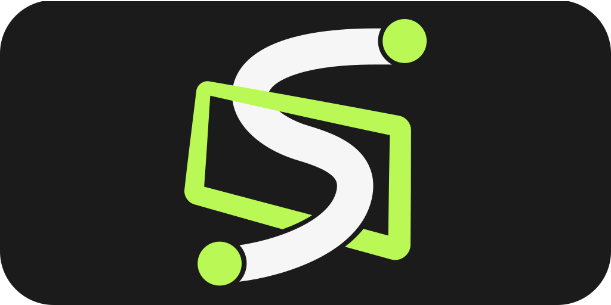
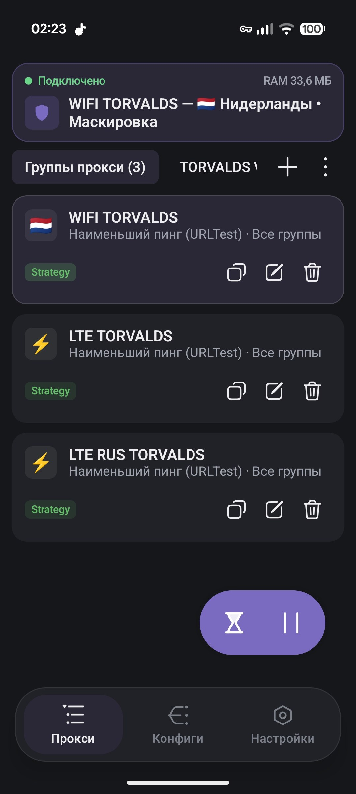
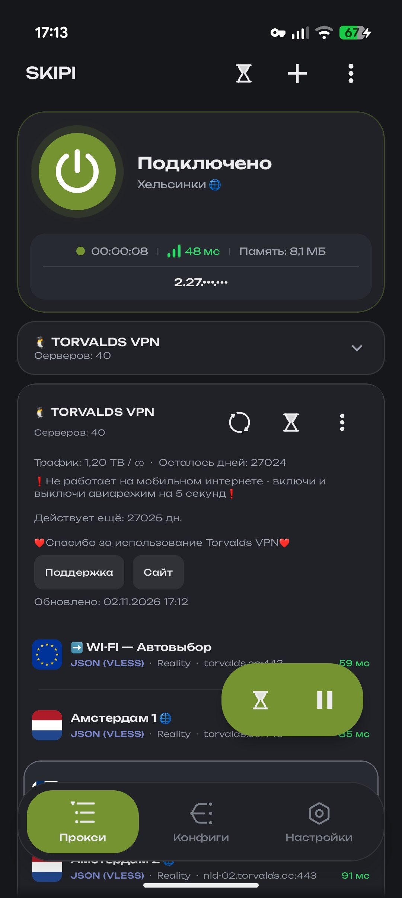
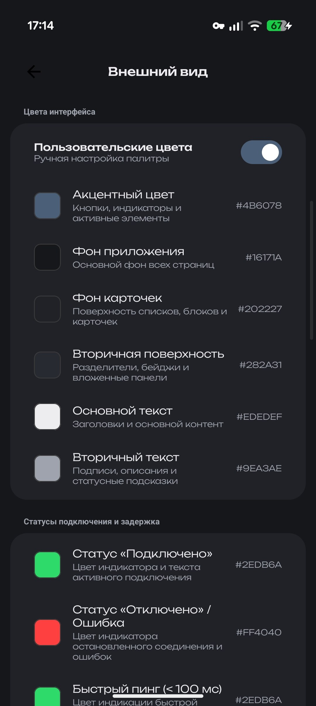
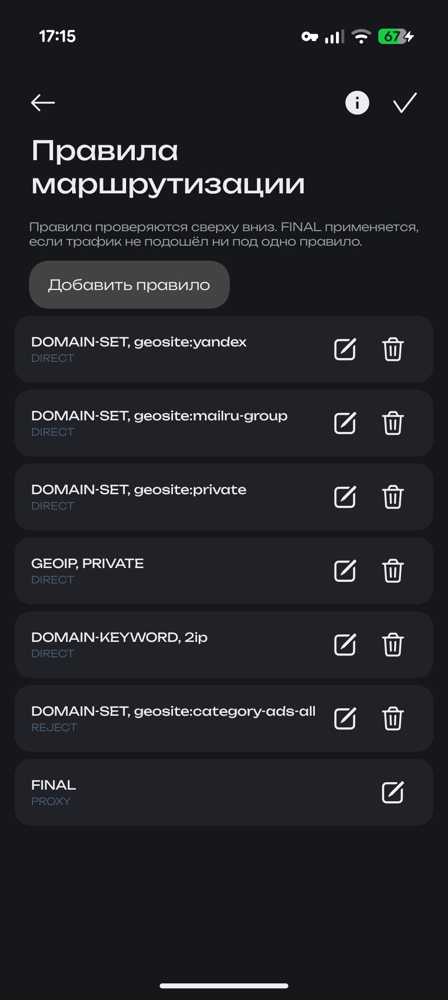
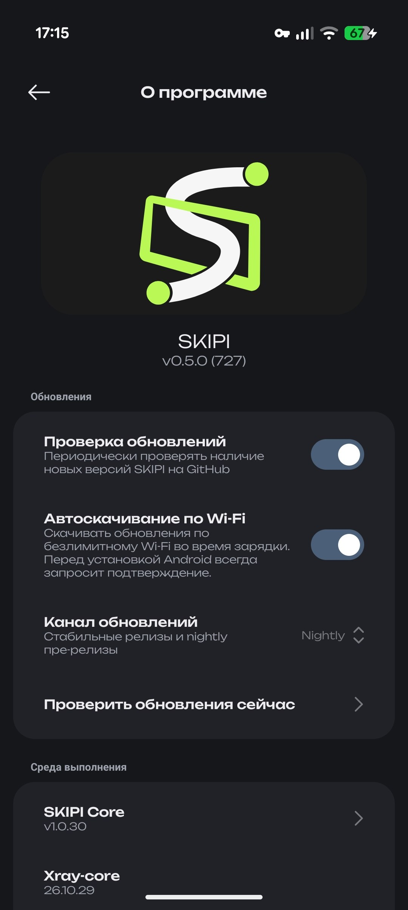

  

  <strong><a href="README.md">Русский</a> | <a href="README_EN.md">English</a> | <a href="README_ZH.md">简体中文</a> | <a href="README_FA.md">فارسی</a></strong>

  Кроссплатформенный клиент для Android, Windows, Linux и macOS

  
  
  
  
  

---

## О проекте

SKIPI является кроссплатформенным клиентом для работы с прокси и туннелями. Одно и то же приложение с общей логикой и общим интерфейсом запускается на Android 7.0 и новее, а также на настольных Windows, Linux и macOS. Интерфейс написан на Compose Multiplatform в стиле Miuix.

Сетевую часть выполняют Xray-core, собственное ядро SKIPI Core, hev-socks5-tunnel и движок AmneziaWG.

Сборки для macOS выпускаются для процессоров Apple Silicon и пока не подписаны и не нотаризованы.

---

## Скриншоты

  
  
  
  
  

---

## Возможности

Клиент поддерживает VLESS, VMess, Trojan, Shadowsocks, Hysteria 2, WireGuard и AmneziaWG, а также SOCKS5, HTTP и произвольные конфигурации Xray в формате JSON. Серверы можно объединять в цепочки и в группы со стратегиями выбора, например с автоматической балансировкой по задержке.

Маршрутизация описывается правилами в формате Shadowrocket (.conf), списками доменов, GeoIP и GeoSite. Для правил есть визуальный редактор. Подписки импортируются в форматах v2rayNG, Clash, Clash Meta (включая шифрование age-ключами) и Base64, а подписки и геобазы обновляются по расписанию.

На Android можно пускать через прокси только выбранные приложения. На настольных системах трафик направляется либо через системный прокси, либо через TUN-интерфейс, а в системном трее появляется значок, через который можно подключиться, отключиться и выйти.

Среди остальных функций есть проверка задержки серверов, измерение скорости, проверка утечек DNS, определение внешнего IP-адреса, автоматическое включение по сети, резервное копирование и восстановление данных. Внешний вид настраивается: темы, акцентные цвета и на Android значок приложения. Обновления приложения можно получать из стабильного канала или из канала nightly, где публикуются предварительные версии.

---

## Протоколы

Для VLESS доступны Reality, XTLS Vision и TLS, а транспортом может быть TCP, WebSocket, gRPC, HTTP/2 и mKCP. VMess работает по тем же транспортам. Trojan поддерживает TLS поверх TCP, WebSocket и gRPC. Shadowsocks поддерживает шифры AEAD и SS-2022 на blake3. Hysteria 2 использует UDP и QUIC. WireGuard работает как обычный UDP-туннель, а AmneziaWG добавляет к нему настраиваемые заголовки и мусорные пакеты для защиты от DPI. SOCKS5 и HTTP применяются как обычные прокси с авторизацией или без неё.

---

## Telegram-канал и чат

Свежие сборки, новости разработки, обсуждение конфигов и помощь с маршрутизацией собраны в канале проекта [@skipi_public](https://t.me/skipi_public).

  

---

## Лицензия

Проект открыт и распространяется под лицензией [GPL-3.0](LICENSE).
