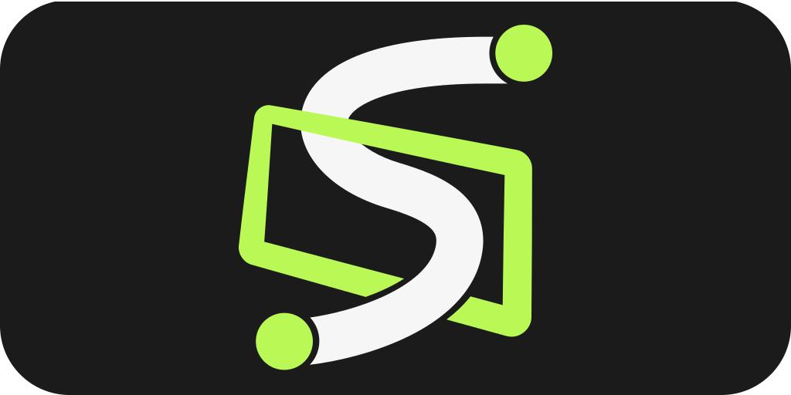
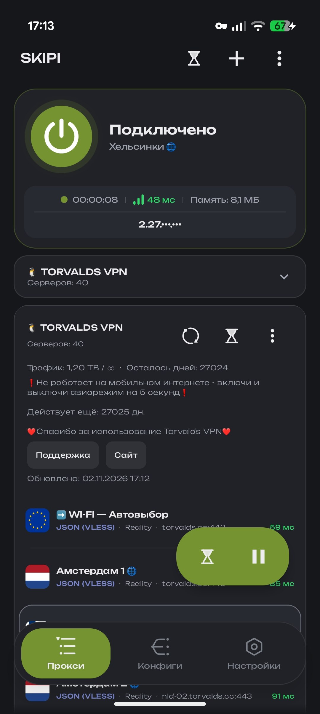
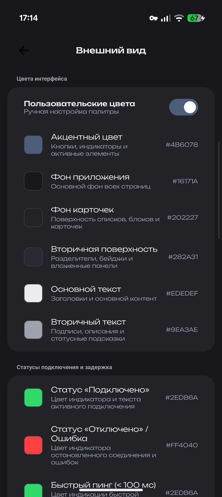
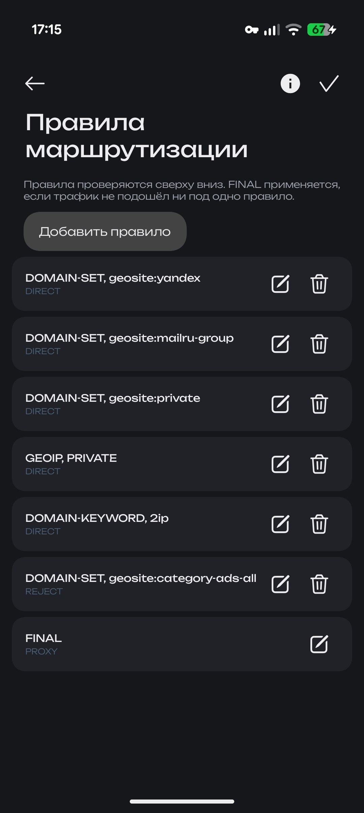
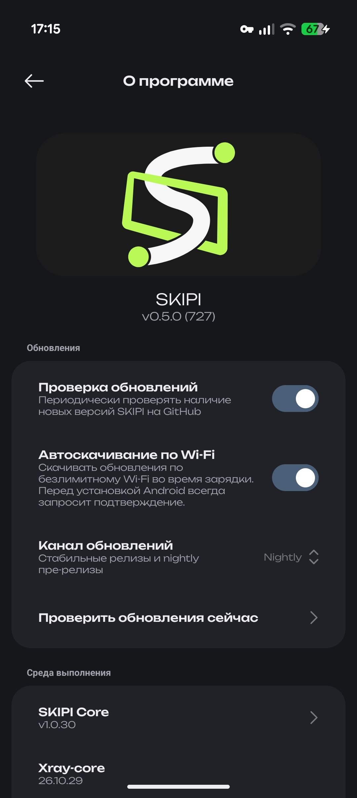

  

  <strong><a href="README.md">Русский</a> | <a href="README_EN.md">English</a> | <a href="README_ZH.md">简体中文</a> | <a href="README_FA.md">فارسی</a></strong>

  A cross-platform client for Android, Windows, Linux and macOS

  
  
  
  
  

---

## About

SKIPI is a cross-platform client for working with proxies and tunnels. The same application, with shared logic and a shared interface, runs on Android 7.0 and later and on desktop Windows, Linux and macOS. The interface is written with Compose Multiplatform in the Miuix style.

The networking is done by Xray-core, the project's own SKIPI Core, hev-socks5-tunnel and the AmneziaWG engine.

The macOS builds are made for Apple Silicon processors and are not yet signed or notarized.

---

## Screenshots

  
  
  
  

---

## Features

The client supports VLESS, VMess, Trojan, Shadowsocks, Hysteria 2, WireGuard and AmneziaWG, as well as SOCKS5, HTTP and arbitrary Xray configurations written in JSON. Servers can be combined into chains and into groups with a selection strategy, for example automatic balancing by latency.

Routing is described by rules in the Shadowrocket (.conf) format, by domain lists, GeoIP and GeoSite, and a visual editor is available for the rules. Subscriptions are imported in the v2rayNG, Clash and Clash Meta formats (including age-key encryption) and in Base64, and both subscriptions and Geo databases are refreshed on a schedule.

On Android, only selected applications can be sent through the proxy. On desktop systems the traffic goes either through the system proxy or through a TUN interface, and a tray icon lets the user connect, disconnect and quit.

Other features include server latency tests, a speed test, a DNS leak check, detection of the external IP address, automatic switching on by network, and backup and restore of user data. The appearance can be customized with themes, accent colors and, on Android, the app icon. Application updates can be taken from the stable channel or from the nightly channel, where pre-releases are published.

---

## Protocols

VLESS is available with Reality, XTLS Vision and TLS, over TCP, WebSocket, gRPC, HTTP/2 and mKCP. VMess works over the same transports. Trojan supports TLS over TCP, WebSocket and gRPC. Shadowsocks supports AEAD ciphers and SS-2022 with blake3. Hysteria 2 uses UDP and QUIC. WireGuard works as an ordinary UDP tunnel, while AmneziaWG adds configurable headers and junk packets to it as a protection against DPI. SOCKS5 and HTTP are used as ordinary proxies, with or without authentication.

---

## Telegram channel and chat

Fresh builds, development news, discussion of configs and help with routing are gathered in the project channel [@skipi_public](https://t.me/skipi_public).

  

---

## License

This project is open-source and distributed under the [GPL-3.0](LICENSE) license.
