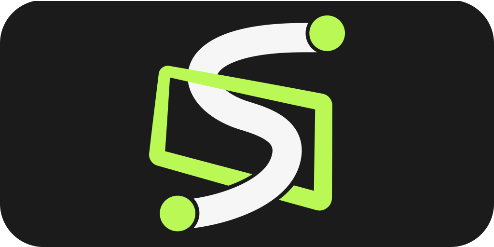
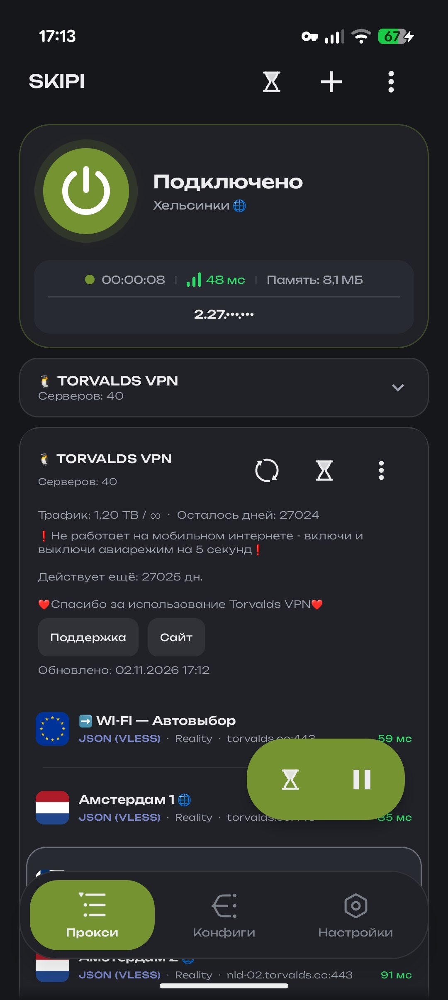
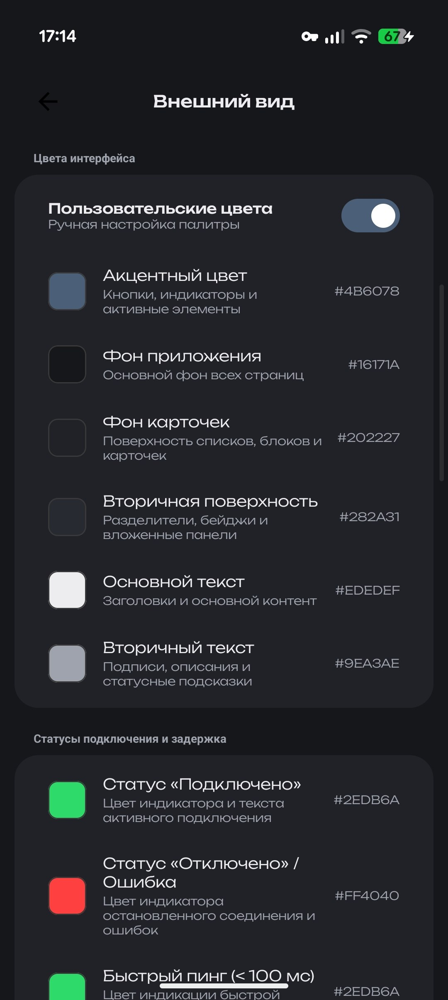
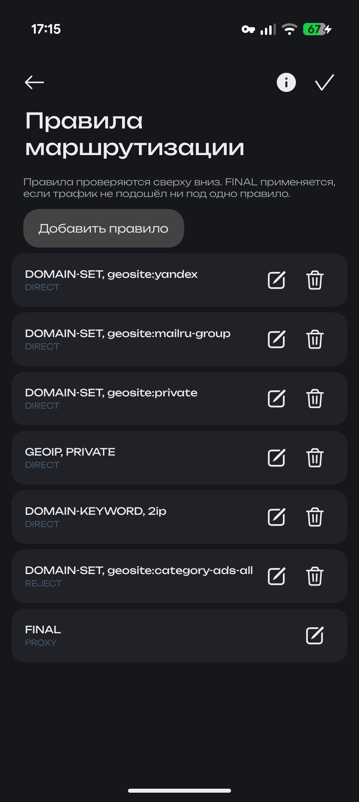
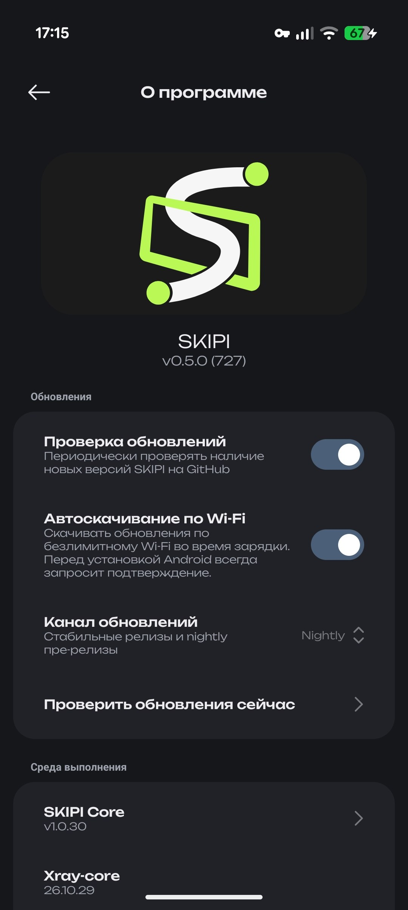

  

  <strong><a href="README.md">Русский</a> | <a href="README_EN.md">English</a> | <a href="README_ZH.md">简体中文</a> | <a href="README_FA.md">فارسی</a></strong>

  کلاینت چندسکویی برای اندروید، ویندوز، لینوکس و macOS

  
  
  
  
  

---

## درباره پروژه

SKIPI یک کلاینت چندسکویی برای کار با پروکسی و تونل است. یک برنامه واحد با منطق و رابط کاربری مشترک روی اندروید ۷٫۰ و بالاتر و همچنین روی ویندوز، لینوکس و macOS اجرا می‌شود. رابط کاربری با Compose Multiplatform و به سبک Miuix نوشته شده است.

بخش شبکه را Xray-core، هسته اختصاصی پروژه یعنی SKIPI Core، hev-socks5-tunnel و موتور AmneziaWG انجام می‌دهند.

نسخه‌های macOS برای پردازنده‌های Apple Silicon ساخته می‌شوند و فعلاً امضا و تأیید نشده‌اند.

---

## تصاویر

  
  
  
  

---

## امکانات

این کلاینت از VLESS، VMess، Trojan، Shadowsocks، Hysteria 2، WireGuard و AmneziaWG پشتیبانی می‌کند و SOCKS5، HTTP و پیکربندی‌های دلخواه Xray را در قالب JSON نیز می‌پذیرد. سرورها را می‌توان در زنجیره‌ها و در گروه‌هایی با راهبرد انتخاب، مثلاً توزیع خودکار بار بر اساس تأخیر، ترکیب کرد.

مسیریابی با قوانینی در قالب Shadowrocket (‎.conf)، فهرست‌های دامنه، GeoIP و GeoSite توصیف می‌شود و برای قوانین یک ویرایشگر بصری وجود دارد. اشتراک‌ها در قالب‌های v2rayNG، Clash، Clash Meta (از جمله رمزگذاری با کلید age) و Base64 وارد می‌شوند و اشتراک‌ها و پایگاه‌های Geo طبق زمان‌بندی به‌روزرسانی می‌شوند.

در اندروید می‌توان فقط برنامه‌های انتخاب‌شده را از پروکسی عبور داد. در سیستم‌های رومیزی ترافیک یا از طریق پروکسی سیستم یا از طریق رابط TUN هدایت می‌شود و نمادی در سینی سیستم برای اتصال، قطع اتصال و خروج وجود دارد.

از امکانات دیگر می‌توان به آزمایش تأخیر سرورها، تست سرعت، بررسی نشت DNS، تشخیص نشانی IP خارجی، روشن‌شدن خودکار بر اساس شبکه و پشتیبان‌گیری و بازیابی داده‌های کاربر اشاره کرد. ظاهر برنامه با تم‌ها و رنگ‌های تأکیدی و در اندروید با آیکون برنامه قابل تنظیم است. به‌روزرسانی برنامه را می‌توان از کانال پایدار یا از کانال nightly که نسخه‌های آزمایشی در آن منتشر می‌شوند دریافت کرد.

---

## پروتکل‌ها

VLESS با Reality، XTLS Vision و TLS و روی TCP، WebSocket، gRPC، HTTP/2 و mKCP در دسترس است. VMess روی همان انتقال‌ها کار می‌کند. Trojan از TLS روی TCP، WebSocket و gRPC پشتیبانی می‌کند. Shadowsocks رمزهای AEAD و SS-2022 با blake3 را پشتیبانی می‌کند. Hysteria 2 از UDP و QUIC استفاده می‌کند. WireGuard مانند یک تونل معمولی UDP کار می‌کند و AmneziaWG سرآیندهای قابل تنظیم و بسته‌های زائد را برای مقابله با DPI به آن اضافه می‌کند. SOCKS5 و HTTP به‌عنوان پروکسی‌های معمولی، با احراز هویت یا بدون آن، به کار می‌روند.

---

## کانال و گفتگوی تلگرام

آخرین نسخه‌ها، اخبار توسعه، بحث درباره پیکربندی‌ها و کمک در زمینه مسیریابی در کانال پروژه [@skipi_public](https://t.me/skipi_public) گردآوری شده است.

  

---

## مجوز

این پروژه متن‌باز است و تحت مجوز [GPL-3.0](LICENSE) منتشر می‌شود.

