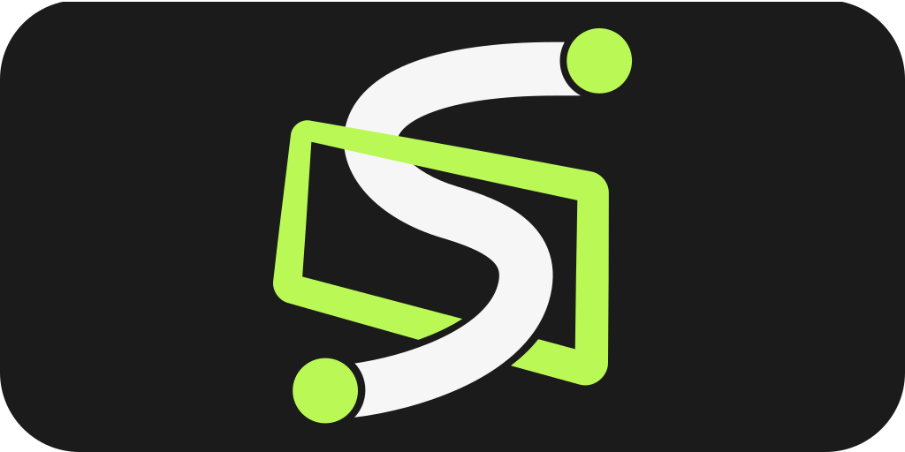
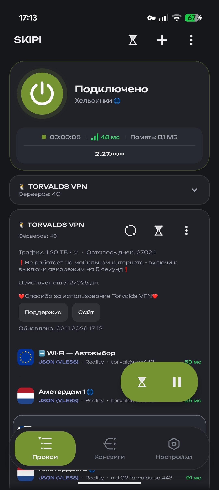
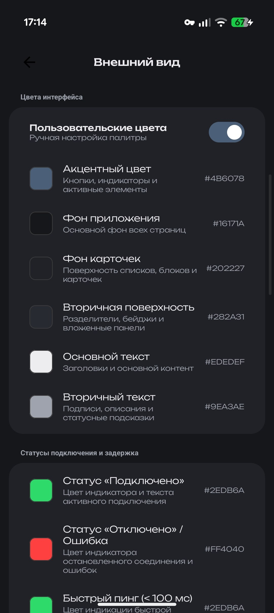
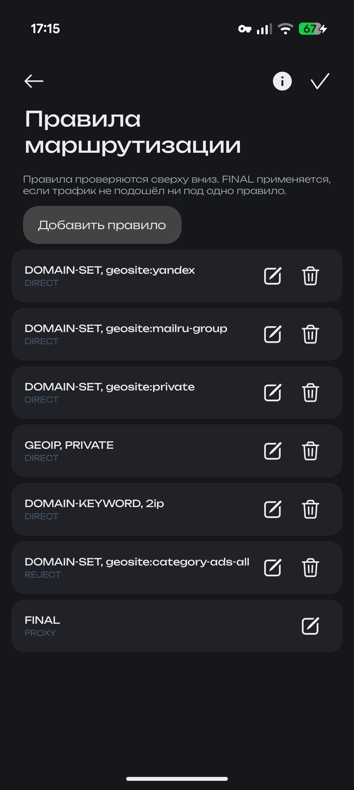
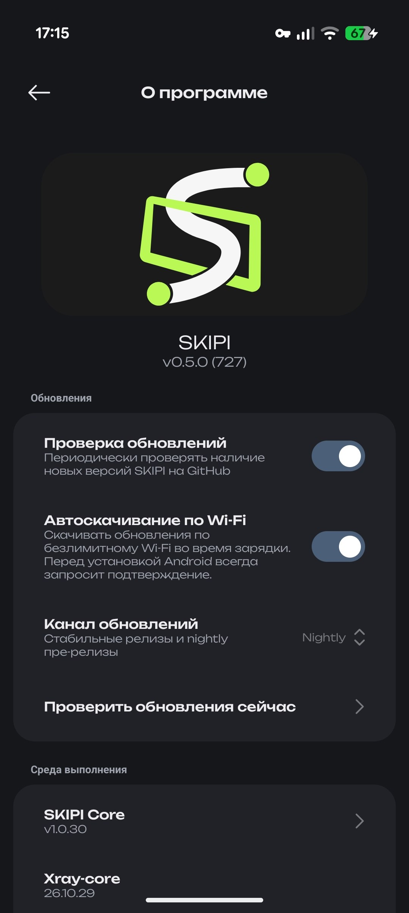

  

  <strong><a href="README.md">Русский</a> | <a href="README_EN.md">English</a> | <a href="README_ZH.md">简体中文</a> | <a href="README_FA.md">فارسی</a></strong>

  适用于 Android、Windows、Linux 和 macOS 的跨平台客户端

  
  
  
  
  

---

## 关于项目

SKIPI 是一款用于代理和隧道的跨平台客户端。同一个应用拥有共用的逻辑和界面，可以在 Android 7.0 及更高版本以及桌面版 Windows、Linux 和 macOS 上运行。界面使用 Compose Multiplatform 编写，采用 Miuix 风格。

网络部分由 Xray-core、项目自有的 SKIPI Core、hev-socks5-tunnel 和 AmneziaWG 引擎完成。

macOS 版本面向 Apple Silicon 处理器构建，目前尚未签名和公证。

---

## 截图

  
  
  
  

---

## 功能

客户端支持 VLESS、VMess、Trojan、Shadowsocks、Hysteria 2、WireGuard 和 AmneziaWG，也支持 SOCKS5、HTTP 以及 JSON 格式的任意 Xray 配置。服务器可以组成代理链，也可以组成带有选择策略的分组，例如按延迟自动负载均衡。

路由通过 Shadowrocket（.conf）格式的规则、域名列表、GeoIP 和 GeoSite 来描述，规则配有可视化编辑器。订阅可以按 v2rayNG、Clash、Clash Meta（包括 age 密钥加密）和 Base64 格式导入，订阅和 Geo 数据库会按计划自动更新。

在 Android 上可以只让选定的应用经过代理。在桌面系统上，流量可以通过系统代理或 TUN 接口转发，系统托盘中的图标可用来连接、断开和退出。

其他功能包括服务器延迟测试、测速、DNS 泄漏检测、外部 IP 地址检测、按网络自动启用，以及用户数据的备份和恢复。外观可以通过主题和强调色自定义，在 Android 上还可以更换应用图标。应用更新可以选择稳定通道，也可以选择发布预览版本的 nightly 通道。

---

## 协议

VLESS 支持 Reality、XTLS Vision 和 TLS，传输方式有 TCP、WebSocket、gRPC、HTTP/2 和 mKCP。VMess 使用相同的传输方式。Trojan 支持基于 TCP、WebSocket 和 gRPC 的 TLS。Shadowsocks 支持 AEAD 加密以及使用 blake3 的 SS-2022。Hysteria 2 使用 UDP 和 QUIC。WireGuard 作为普通的 UDP 隧道工作，AmneziaWG 在此基础上加入可配置的报头和垃圾数据包，用于对抗 DPI。SOCKS5 和 HTTP 作为普通代理使用，可以带认证，也可以不带。

---

## Telegram 频道和聊天

最新构建、开发动态、配置讨论以及路由方面的帮助都集中在项目频道 [@skipi_public](https://t.me/skipi_public)。

  

---

## 许可证

本项目是开源项目，基于 [GPL-3.0](LICENSE) 许可证发布。
